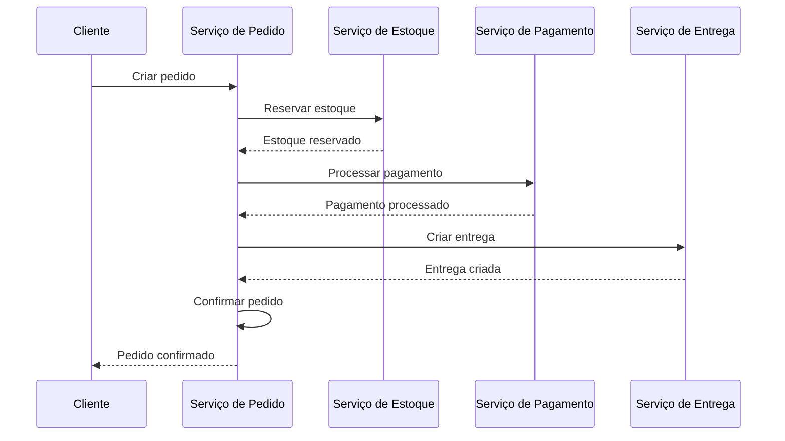
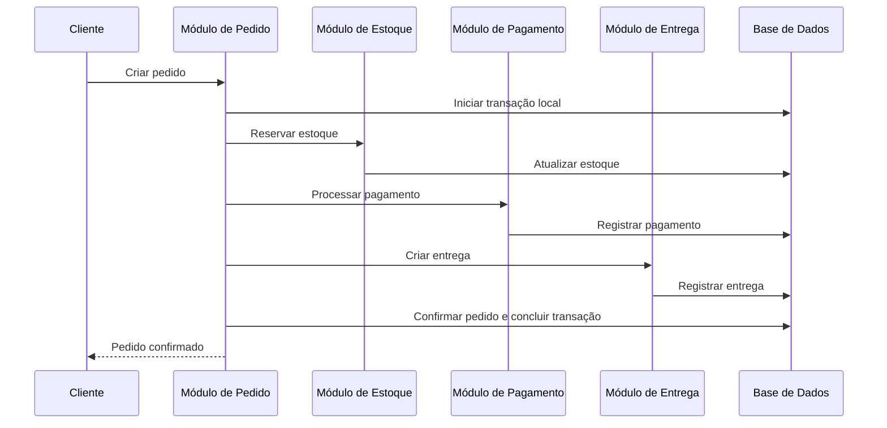
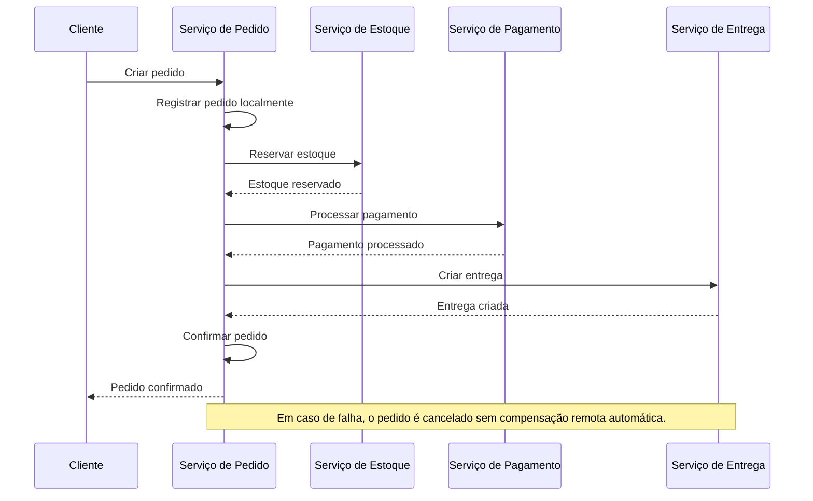
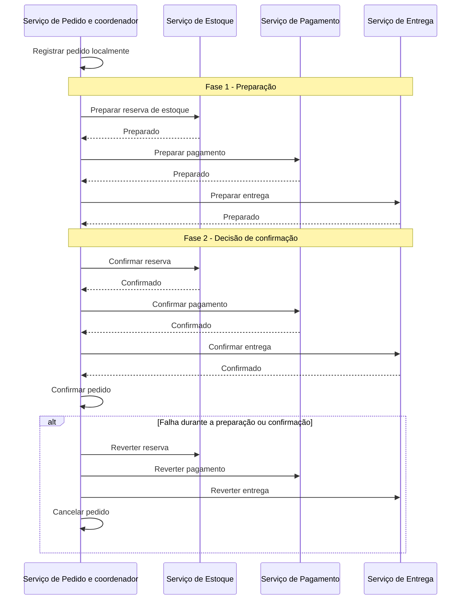
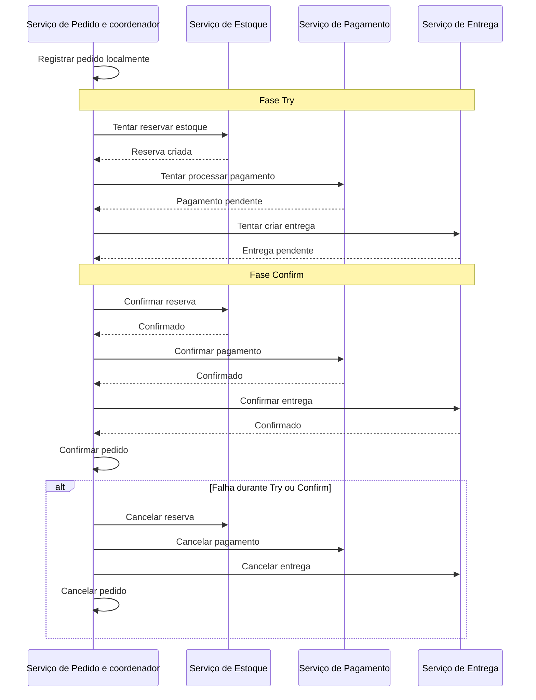
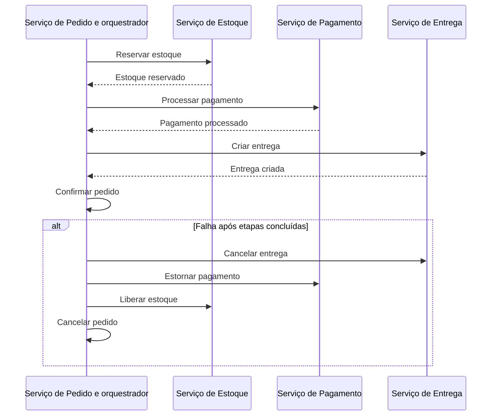
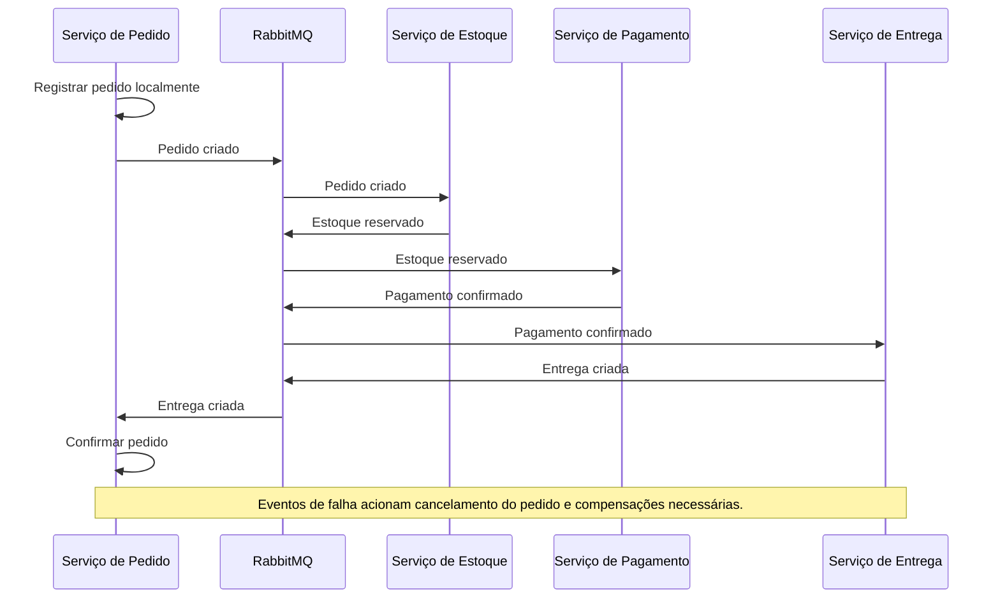
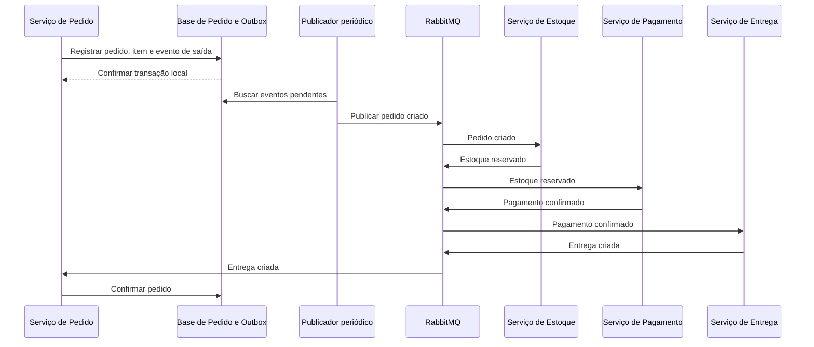

## 4.3.1 Sistema experimental

O sistema experimental representa um domínio de comércio eletrônico no qual a realização de uma compra exige a coordenação de quatro responsabilidades de negócio: pedido, estoque, pagamento e entrega. O objetivo é preservar o mesmo comportamento funcional nas versões avaliadas, variando apenas a estratégia utilizada para coordenar as operações distribuídas.

O fluxo principal inicia com a criação do pedido. Em seguida, o estoque correspondente é reservado, o pagamento é processado e a entrega é criada. O pedido é confirmado somente após a conclusão das etapas necessárias. Caso ocorra uma falha, o comportamento depende da estratégia transacional adotada: a operação pode ser revertida por rollback local, cancelada, compensada ou concluída de forma assíncrona.

Na versão monolítica, as quatro responsabilidades são módulos da mesma aplicação e compartilham uma única base de dados. Nas versões distribuídas, elas são separadas em serviços independentes, cada um responsável pelo próprio estado persistente. Dessa forma, a criação de um pedido constitui uma única transação de negócio formada por múltiplas operações locais.

## 4.3.2 Infraestrutura e tecnologias

As aplicações foram implementadas em TypeScript, utilizando NestJS 11 sobre Node.js 22. A persistência é realizada em PostgreSQL 15. A versão monolítica utiliza uma única base de dados, enquanto as versões distribuídas mantêm bases separadas para os contextos de pedido, estoque, pagamento e entrega. Essa separação permite avaliar os efeitos da ausência de uma transação única compartilhada entre os serviços.

As arquiteturas baseadas em eventos utilizam RabbitMQ 4 como intermediário de mensagens. Esse componente é empregado pela saga coreografada e pela versão baseada em Outbox, nas quais a continuidade do fluxo ocorre por eventos de domínio. As demais versões distribuídas utilizam comunicação síncrona entre os serviços.

O ambiente é provisionado por Docker Compose, de modo que aplicações, bancos de dados, proxy reverso e, quando necessário, broker de mensagens possam ser iniciados a partir de configurações reproduzíveis. O Nginx atua como ponto de entrada para as requisições HTTP, adota uma política de encaminhamento baseada no menor número de conexões ativas e reutiliza conexões com os serviços internos.

Não são utilizadas réplicas de aplicação nos experimentos. Cada serviço possui uma única instância, e o Nginx é empregado como proxy reverso e ponto de entrada da arquitetura, não como mecanismo de distribuição de requisições entre múltiplas réplicas. Essa decisão reduz variáveis de confusão associadas ao escalonamento horizontal e concentra a comparação no custo das estratégias de coordenação transacional.

## 4.3.3 Ambiente de execução

Os ensaios devem ser executados sob condições controladas, mantendo constantes o domínio de negócio, o conjunto de dados inicial, as versões de software, a configuração de rede e a quantidade de instâncias de cada serviço. Cada execução deve iniciar a partir de um estado limpo, seguido pelo carregamento do mesmo conjunto de dados, para evitar que pedidos de execuções anteriores alterem a disponibilidade de estoque ou a distribuição de dados persistidos.

O conjunto inicial contém 100 produtos, cada um com 100.000 unidades disponíveis. Todos os pedidos utilizam uma unidade de um produto existente, o que reduz a influência de variações causadas por indisponibilidade inicial de estoque. As configurações de banco de dados e de rede devem ser mantidas idênticas entre versões comparáveis. Nas arquiteturas que dependem de RabbitMQ, o broker é iniciado juntamente com os demais componentes, sem alterar as condições dos serviços que não utilizam mensageria.

O Docker Compose fornece isolamento entre os componentes da aplicação por meio de redes internas. Para reduzir interferências externas, recomenda-se executar os ensaios sem outras cargas relevantes no host e registrar qualquer limite de CPU, memória ou rede imposto aos contêineres. Não devem ser utilizadas réplicas; portanto, cada serviço é executado em uma única instância durante os ensaios.

As características físicas e de sistema operacional não podem ser deduzidas da configuração da aplicação. Elas devem ser informadas no texto final para permitir a reprodutibilidade do experimento.

| Item a registrar | Valor utilizado nos experimentos |
| --- | --- |
| Processador | `[preencher: modelo e número de núcleos lógicos]` |
| Memória RAM | `[preencher: capacidade disponível]` |
| Sistema operacional | `[preencher: distribuição e versão]` |
| Versão do Docker e Docker Compose | `[preencher]` |
| Versão do PostgreSQL | `15` |
| Versão do Node.js | `22` |
| Versão do NestJS | `11` |
| Versão do RabbitMQ, quando aplicável | `4` |
| Número de instâncias por serviço | `1` |
| Configuração de rede | `Rede interna do Docker Compose; registrar limitações externas, se houver` |
| Isolamento do host | `[preencher: processos concorrentes, limites de CPU/RAM e política de execução]` |

## 4.3.4 Versões avaliadas

As versões avaliadas preservam o fluxo de negócio descrito anteriormente e diferem na forma como coordenam as alterações de estado entre pedido, estoque, pagamento e entrega. A seguir, apresenta-se a concretização de cada arquitetura no laboratório, sem retomar a discussão conceitual dos padrões transacionais.

### V1 — Monólito com transação local

Na versão monolítica, pedido, estoque, pagamento e entrega executam na mesma aplicação e utilizam a mesma base de dados. A criação do pedido é realizada como uma única transação local: todas as alterações são confirmadas conjuntamente ao final do fluxo ou revertidas caso ocorra uma falha. Essa versão constitui a referência para avaliar o custo adicional introduzido pela distribuição dos componentes e pelos mecanismos de coordenação.

### V2 — Arquitetura distribuída sem coordenação global

Nesta versão, os serviços de pedido, estoque, pagamento e entrega possuem bases de dados próprias. O Serviço de Pedido inicia o fluxo e chama os demais serviços de forma síncrona e sequencial. Cada participante confirma sua própria operação local. Quando uma etapa falha, o pedido é cancelado, mas não existe um mecanismo global para desfazer automaticamente os efeitos já confirmados pelos participantes anteriores.

### V3 — Two-Phase Commit (2PC)

Na versão baseada em 2PC, o Serviço de Pedido atua como coordenador da transação. Ele registra o pedido localmente e solicita que os serviços de estoque, pagamento e entrega preparem suas respectivas operações. Depois que todos os participantes concluem a preparação, o coordenador envia a decisão de confirmação. Caso ocorra falha em qualquer etapa, o coordenador solicita a reversão das operações preparadas e cancela o pedido.

Nesta concretização, a coordenação ocorre no nível da aplicação, por meio de mensagens de preparação, confirmação e reversão entre os serviços.

### V4 — Try-Confirm-Cancel (TCC)

Na versão baseada em TCC, o Serviço de Pedido coordena operações explícitas de tentativa, confirmação e cancelamento. A fase de tentativa reserva recursos sem consolidar definitivamente o efeito de negócio. Quando todos os participantes concluem essa fase, as operações são confirmadas. Se houver falha, as tentativas realizadas são canceladas e o pedido é marcado como cancelado.

### V5 — Saga orquestrada

Na saga orquestrada, o Serviço de Pedido é responsável por conduzir o fluxo completo e manter o conhecimento sobre as etapas concluídas. As operações de estoque, pagamento e entrega são realizadas sequencialmente. Se uma falha ocorrer após a conclusão de uma ou mais etapas, o orquestrador solicita operações compensatórias em ordem inversa: cancelamento da entrega, estorno do pagamento e liberação do estoque. Ao término dessa tentativa de compensação, o pedido é cancelado.

### V6 — Saga coreografada

Na saga coreografada, não há um coordenador central. Após o registro inicial do pedido, o Serviço de Pedido publica um evento de criação. Os serviços de estoque, pagamento e entrega reagem a eventos e publicam os eventos que dão continuidade ao fluxo. A confirmação do pedido ocorre quando o Serviço de Pedido recebe o evento que indica a criação bem-sucedida da entrega. Eventos de falha disparam as ações compensatórias correspondentes nos participantes afetados.

### V7 — Outbox com saga baseada em eventos

A versão baseada em Outbox mantém a comunicação orientada a eventos da saga coreografada, mas registra a alteração local de negócio e o evento a ser publicado na mesma transação local. Um processo periódico identifica os eventos pendentes e os publica no RabbitMQ. Depois da publicação, os serviços continuam o fluxo por eventos até a criação da entrega e a confirmação do pedido.

Nessa arquitetura, a garantia direta é local: o estado de negócio e o registro do evento de saída são confirmados conjuntamente. A publicação do evento e a conclusão entre serviços permanecem assíncronas.
