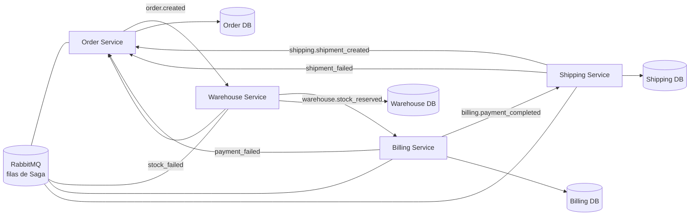

# Choreographed Saga

## Visão geral

Nesta versão, a Saga é coordenada por eventos publicados no RabbitMQ. Não existe um serviço central responsável por chamar cada etapa. Cada serviço consome eventos de interesse, executa sua operação local e publica o próximo evento.

## Fluxo de sucesso

1. O `order-service` cria o pedido e publica `order.created` na fila do warehouse.
2. O warehouse reserva o estoque e publica `warehouse.stock_reserved`.
3. O billing processa o pagamento e publica `billing.payment_completed`.
4. O shipping cria a entrega e publica `shipping.shipment_created`.
5. O order-service consome o evento da entrega e marca o pedido como confirmado.

## Fluxo de compensação

Falhas são publicadas como eventos, por exemplo `warehouse.stock_failed`, `billing.payment_failed` ou `shipping.shipment_failed`. Os serviços interessados consomem esses eventos e executam as ações de compensação necessárias, como liberar o estoque, estornar o pagamento ou cancelar a entrega.

## Características

A coreografia reduz a dependência de um coordenador central e permite que cada serviço evolua seus consumidores. Em troca, o fluxo completo fica distribuído entre vários handlers, tornando rastreamento, ordenação, duplicidade e compreensão das compensações mais difíceis.
