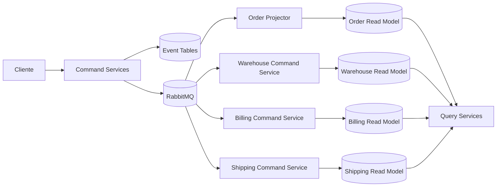

# CQRS

## Visão geral

O CQRS separa as operações de escrita das operações de leitura. Nesta implementação, comandos geram eventos persistidos, enquanto projetores atualizam tabelas usadas pelas consultas.

O RabbitMQ distribui comandos e eventos entre os serviços. Cada domínio possui serviços de comando, serviços de consulta, entidades de eventos e projetores.

## Fluxo de escrita e leitura

1. O cliente envia um comando para criar o pedido.
2. O `OrderCommandService` grava o evento `OrderPlaced`.
3. O evento é publicado para o projetor de pedidos e para o warehouse.
4. Os serviços participantes geram seus próprios eventos e atualizam suas projeções.
5. Consultas ao pedido leem a tabela projetada pelo `OrderQueryService`.
6. Endpoints de replay permitem reconstruir projeções a partir dos eventos armazenados.

## Características

O CQRS permite otimizar separadamente escrita e leitura e reconstruir projeções. Ele introduz consistência eventual entre evento e projeção, duplicação de modelos e maior complexidade operacional. CQRS não exige event sourcing por si só, embora esta implementação use eventos persistidos para alimentar as projeções.
