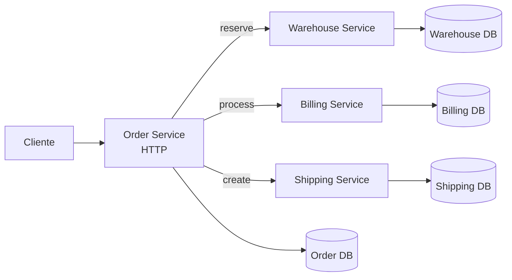

# Distributed Baseline

## Visão geral

Esta implementação separa o sistema em quatro serviços NestJS independentes. O `OrderService` coordena o fluxo por meio de chamadas HTTP síncronas para os serviços de warehouse, billing e shipping.

Cada serviço possui seu próprio banco PostgreSQL. O baseline serve como referência para comparar a comunicação distribuída sem um protocolo explícito de transação ou de compensação.

## Componentes

- `order-service`: cria o pedido e chama os demais serviços.
- `warehouse-service`: reserva estoque.
- `billing-service`: processa e pode estornar pagamentos.
- `shipping-service`: cria e consulta entregas.
- Quatro bancos PostgreSQL independentes.

## Fluxo

1. O pedido é salvo no banco do serviço de pedidos.
2. O coordenador chama `PATCH /warehouse/reserve`.
3. Em seguida chama `POST /billing/process`.
4. Depois chama `POST /shipping`.
5. Se todas as chamadas funcionarem, o pedido é confirmado.
6. Se alguma chamada falhar, o pedido local é marcado como cancelado.

O baseline não desfaz automaticamente as operações remotas que já foram concluídas. Por exemplo, uma falha no pagamento pode deixar o estoque já decrementado.

## Características

O modelo é simples e evidencia os problemas básicos de uma transação distribuída: latência acumulada, falhas parciais e ausência de rollback remoto. Ele é uma boa linha de base para avaliar TCC, 2PC e Sagas.
