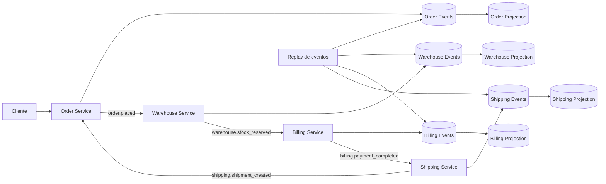

# Event Sourcing

## Visão geral

Nesta implementação, os eventos de domínio são armazenados como o registro principal das mudanças. O estado atual de pedidos, pagamentos, estoque e entregas pode ser reconstruído reproduzindo os eventos na ordem de criação.

Os serviços também mantêm tabelas de estado para consultas rápidas, mas essas tabelas são tratadas como projeções derivadas. Cada serviço possui um repositório de eventos e expõe endpoints de replay.

## Fluxo de exemplo

1. O `order-service` gera e persiste `OrderPlaced`.
2. O evento é publicado para o warehouse.
3. O warehouse persiste eventos como `ProductCreated` e `StockDecreased`.
4. O billing persiste eventos de pagamento e publica `billing.payment_completed`.
5. O shipping persiste o evento de criação da entrega.
6. O order-service persiste `OrderShipmentLinked`.
7. Cada serviço pode executar replay para reconstruir sua projeção atual.

## Características

O event sourcing preserva o histórico completo e permite reconstruir o estado ou criar novas projeções. Em contrapartida, exige versionamento de eventos, cuidado com ordenação e evolução de esquemas, além de maior custo de armazenamento e processamento durante replays.
