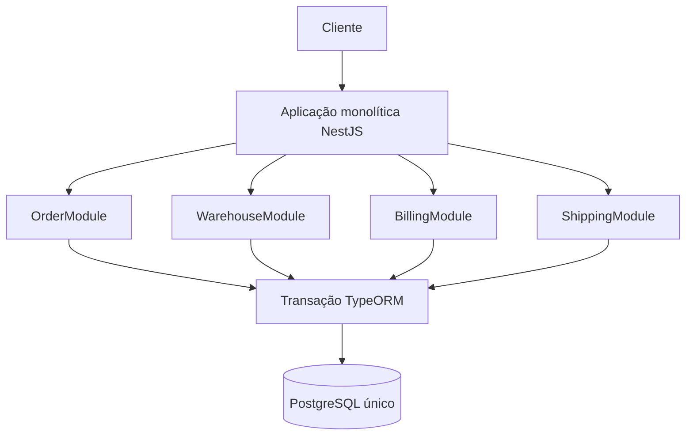

# Monólito

## Visão geral

Esta implementação concentra os domínios de pedidos, estoque, pagamentos e entregas em uma única aplicação NestJS. Todos os módulos são executados no mesmo processo e compartilham o mesmo banco PostgreSQL.

O pedido é criado pelo `OrderService`, que controla uma transação TypeORM. A reserva de estoque, o processamento do pagamento e a criação da entrega usam o mesmo `QueryRunner`, de modo que uma falha em qualquer etapa provoca rollback das alterações realizadas.

## Componentes

- `OrderModule`: cria pedidos e itens.
- `WarehouseModule`: consulta e altera produtos e estoque.
- `BillingModule`: registra pagamentos.
- `ShippingModule`: registra entregas e códigos de rastreamento.
- PostgreSQL único: armazena pedidos, produtos, pagamentos e entregas.

## Fluxo

1. O cliente envia os dados do pedido para o endpoint de pedidos.
2. O sistema inicia uma transação no banco.
3. O produto é consultado e o estoque é decrementado atomicamente.
4. O pedido e seu item são persistidos.
5. O pagamento é processado.
6. A entrega é criada.
7. O pedido é marcado como confirmado e a transação é efetivada.
8. Se uma etapa falhar, a transação é desfeita.

## Características

O principal benefício é a consistência transacional simples: não há chamadas de rede nem necessidade de compensações distribuídas. Em contrapartida, os módulos ficam implantados juntos e compartilham o mesmo banco, reduzindo o isolamento e a possibilidade de escalar cada domínio separadamente.
