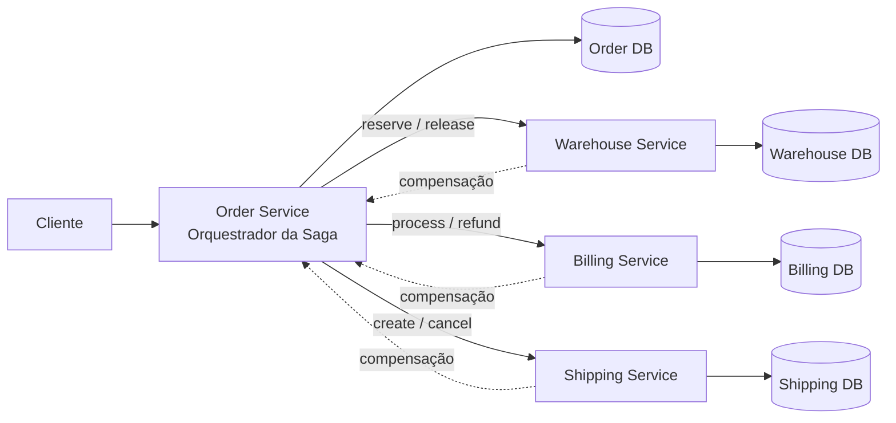

# Orchestrated Saga

## Visão geral

Nesta implementação, o `OrderService` atua como coordenador central da Saga. Os serviços continuam separados e se comunicam por HTTP, mas cada participante oferece uma operação compensatória para desfazer seu efeito local.

O coordenador mantém o estado do pedido e registra quais etapas foram concluídas em memória durante a execução. Em caso de falha, solicita as compensações das etapas concluídas, na ordem inversa do fluxo original.

## Componentes

- `order-service`: orquestrador da Saga e proprietário do estado do pedido.
- `warehouse-service`: expõe reserva e liberação de estoque.
- `billing-service`: expõe processamento e estorno de pagamento.
- `shipping-service`: expõe criação e cancelamento de entrega.
- Um banco PostgreSQL por serviço.

## Fluxo de sucesso

1. O pedido e o item são salvos no `order-db`.
2. O orquestrador chama `PATCH /warehouse/reserve`.
3. Chama `POST /billing/process`.
4. Chama `POST /shipping`.
5. O pedido é marcado como `CONFIRMED`.

## Fluxo de compensação

Quando uma etapa falha, o orquestrador compensa somente as etapas que já tiveram sucesso:

1. Cancela a entrega, se ela foi criada.
2. Solicita o estorno, se o pagamento foi processado.
3. Libera o estoque, se a reserva foi realizada.
4. Marca o pedido como `CANCELLED`.

As compensações são tentadas sequencialmente e continuam mesmo quando uma compensação individual falha. Falhas de compensação são registradas em log para tratamento posterior.

## Características

A orquestração torna o fluxo e as compensações explícitos em um único lugar. Isso facilita acompanhar a Saga, mas concentra a lógica de coordenação no serviço de pedidos e exige que todas as operações compensatórias sejam idempotentes e confiáveis.
