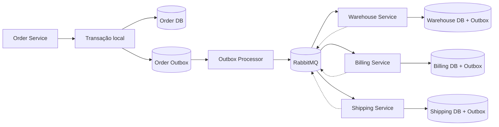

# Outbox

## Visão geral

Esta implementação combina uma Saga coreografada com o padrão Transactional Outbox. Cada serviço grava a alteração de negócio e a mensagem que precisa publicar na mesma transação local.

Um processador periódico consulta os registros pendentes da tabela `outbox` e publica as mensagens no RabbitMQ. Depois, marca o registro como processado ou falho.

## Fluxo

1. O `order-service` inicia uma transação local.
2. Salva o pedido, o item e o evento `order.created` na tabela outbox.
3. A transação é confirmada.
4. O processador do outbox publica a mensagem no RabbitMQ.
5. Warehouse, billing e shipping continuam o fluxo por eventos, como na Saga coreografada.
6. Cada serviço também pode registrar suas próprias mensagens de saída no outbox.

## Características

O outbox evita o problema de confirmar dados no banco e perder a mensagem durante a publicação. A publicação passa a ser eventual e recuperável. Ainda é necessário tratar duplicidade, reprocessamento, mensagens falhas e idempotência dos consumidores.
