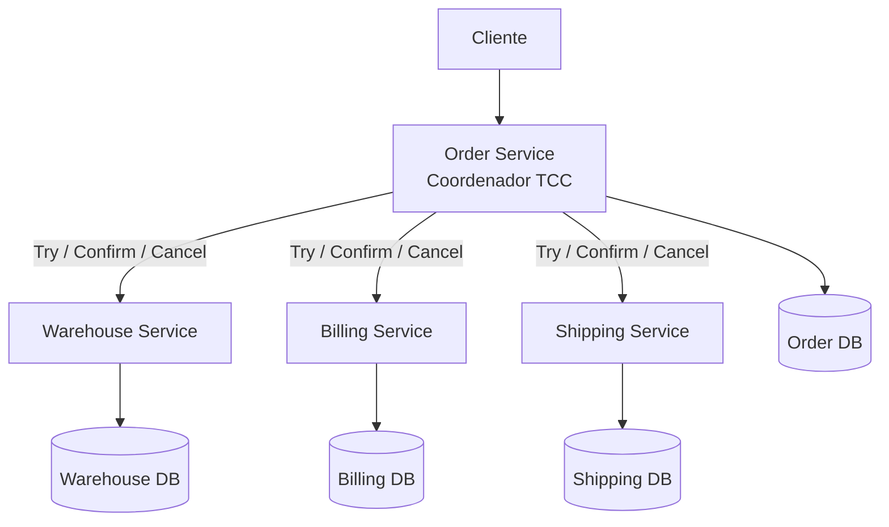

# TCC — Try, Confirm, Cancel

## Visão geral

O padrão TCC divide cada operação distribuída em três ações: `Try`, `Confirm` e `Cancel`. O serviço de pedidos coordena essas ações por HTTP.

Durante o `Try`, cada participante prepara uma operação reversível. Somente depois que todos os participantes aceitam a tentativa o coordenador envia `Confirm`. Se alguma tentativa falhar, envia `Cancel` aos participantes que possam ter reservado recursos.

## Componentes

- `order-service`: coordenador das fases TCC.
- `warehouse-service`: tenta reservar, confirma ou cancela a reserva.
- `billing-service`: tenta registrar o pagamento, confirma ou cancela.
- `shipping-service`: tenta preparar a entrega, confirma ou cancela.
- Bancos PostgreSQL separados para cada serviço.

## Fluxo

1. O pedido é criado localmente.
2. O coordenador executa `Try` no warehouse, billing e shipping.
3. Se todos os `Try` forem concluídos, executa `Confirm` nos três serviços.
4. Se algum `Try` ou `Confirm` falhar, executa `Cancel` nos participantes.
5. O pedido é confirmado ou cancelado conforme o resultado.

## Características

O TCC mantém reservas explícitas antes da confirmação definitiva e permite que cada participante controle sua própria preparação. O custo é maior complexidade nos serviços, necessidade de estados intermediários e necessidade de tratar confirmações ou cancelamentos repetidos.
