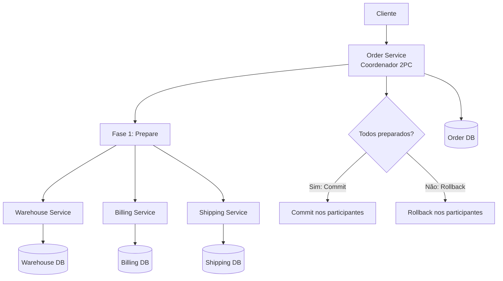

# Two-Phase Commit

## Visão geral

Esta implementação simula o protocolo Two-Phase Commit, ou 2PC, sobre chamadas HTTP. O coordenador divide o processamento em uma fase de preparação e uma fase de commit.

Cada participante prepara sua alteração sem torná-la definitiva. O commit só é enviado quando warehouse, billing e shipping responderam positivamente à preparação.

## Componentes

- `order-service`: coordenador do protocolo 2PC.
- `warehouse-service`: prepara, confirma ou desfaz a reserva de estoque.
- `billing-service`: prepara, confirma ou desfaz o pagamento.
- `shipping-service`: prepara, confirma ou desfaz a entrega.
- Bancos PostgreSQL separados.

## Fluxo

1. O pedido e o item são persistidos no banco de pedidos.
2. O coordenador envia `prepare` ao warehouse.
3. Envia `prepare` ao billing.
4. Envia `prepare` ao shipping.
5. Se todos estiverem preparados, envia `commit` aos três participantes.
6. Se houver falha, envia `rollback` aos participantes.

## Características

O 2PC busca uma decisão uniforme entre os participantes, mas mantém recursos preparados por mais tempo e torna o coordenador um ponto crítico. Em ambientes distribuídos reais, indisponibilidade do coordenador pode deixar participantes bloqueados aguardando uma decisão.
